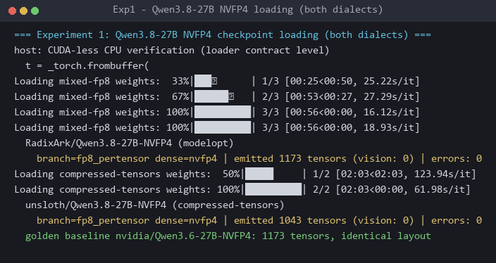
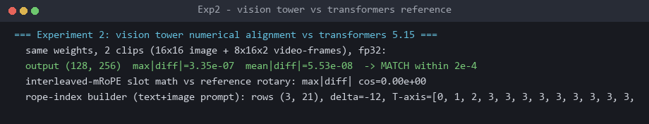
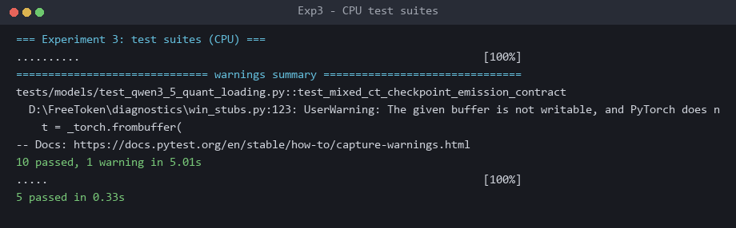

# FreeToken(个人 Fork,中文版)

[English](README.md) | **简体中文**

> **Fork 声明** · 本仓库是
> [FlashML-org/FreeToken](https://github.com/FlashML-org/FreeToken)(Apache-2.0)的个人
> fork,在上游 `main@2757bb5` 之上新增了 **Qwen3.8-27B NVFP4 支持(两种量化方言)**
> 与 **Qwen3.5/3.6/3.8 视觉输入**(对齐 gemma4 的支持级别)。
> 变更详情、验证状态与版本说明见 **[CHANGES.md](CHANGES.md)** ·
> fork 标签 `qwen38-vision-v1.0.0`。

<div align="center">
  <picture>
    <source media="(prefers-color-scheme: dark)" srcset="https://raw.githubusercontent.com/FlashML-org/FreeToken/main/assets/freetoken-logo-dark.svg">
    <source media="(prefers-color-scheme: light)" srcset="https://raw.githubusercontent.com/FlashML-org/FreeToken/main/assets/freetoken-logo-light.svg">
    
  </picture>
</div>

<p align="center">
| [论文](https://arxiv.org/abs/2608.16157) | [上游仓库](https://github.com/FlashML-org/FreeToken) |
</p>


在你已有的硬件上解锁数据中心级智能——在游戏 PC 上本地运行 290B+ 前沿 MoE 模型,获得极速交互体验。


## ✨ 本 Fork 新增能力

在上游 `main@2757bb5` 之上叠加两个功能(详情与验证:[CHANGES.md](CHANGES.md)):

**1 · Qwen3.8-27B NVFP4 支持——两种量化方言**

```bash
ft serve --model RadixArk/Qwen3.8-27B-NVFP4      # modelopt 方言
ft serve --model unsloth/Qwen3.8-27B-NVFP4       # compressed-tensors 混合 FP8+FP4
```
修复 #139 一类加载崩溃(剥离版 `hf_quant_config.json` 的误检测),unsloth
混合精度布局原生服务(FP8 W8A16 注意力 + 加载时 RTN 重量化其 FP8 MLP 层)。
稠密 27B NVFP4 权重全量驻显存,需约 22GB 显存。

**2 · Qwen3.5/3.6/3.8 视觉输入(对齐 gemma4 级别)**

```python
llm = LLM(model="...", ...)          # 以 FREETOKEN_LOAD_VISION=1 启动
out = llm.generate(
    [含图像占位符的token序列],
    SamplingParams(...),
    mm_inputs=[{"pixel_values": px, "grid_thw": thw}],   # 来自 HF processor
)
```
视觉塔/merger 与 transformers 参考实现逐位对齐;交错 mRoPE 位置由 `grid_thw`
自动构建;纯文本构建与上游逐位一致。FTW 转换同样须带 `FREETOKEN_LOAD_VISION=1`。

**验证实验**(CPU 加载器级 + 数值对齐;另已在 NVIDIA A10 24GB / CUDA 13 上完成
`RadixArk/Qwen3.8-27B-NVFP4` 的端到端 `ft serve` 冒烟):

| 实验一——真实检查点加载 | 实验二——数值对齐 |
|---|---|
|  |  |

| 实验三——CPU 测试套件(15 项全部通过) |
|---|
|  |

## 简介

FreeToken 是一个边缘原生的混合专家(MoE)推理引擎,面向在个人与消费级硬件上运行前沿规模的开源权重模型。它将异构边缘资源——GPU、CPU、主机内存与互连——视为统一的弹性推理平台。核心特性包括:

- **高速边缘原生运行时**:带宽自适应的 CPU–GPU 协同执行($q^\star$ 策略)、全层双缓冲 prefill 流式处理、全局 LRU 专家缓存、兼容 CUDA Graph 的执行,以及 FTW 快速权重格式。
- **语义感知缓存**:为循环状态与 KV 缓存提供语义锚点检查点,让 Agent 场景的上下文编辑(如工具调用、思考块)避免重复重算上下文。
- **弹性显存管理**:运行时在专家缓存与 KV 内存之间动态重分配显存,无需重启引擎或重载权重。
- **广泛的 MoE 与生态支持**:支持各参数规模与量化格式(MXFP4、NVFP4、FP8、BF16)的前沿开源 MoE 模型(如 DeepSeek-V4-Flash、Qwen3.6-35B-A3B、GLM-5.2),提供 Anthropic/OpenAI 兼容 API,可与真实编码与工具调用 Agent(Codex、Claude Code、OpenCode、OpenClaw、DeepSeek Harness 等)无缝集成。
- **多样的消费级硬件**:覆盖消费级笔记本、游戏台式机与工作站 GPU,原生支持 NVIDIA RTX 30/40/50 系列。

## 快速开始

> 上游官方 **Desktop 桌面版**(flashml.ai)是独立的官方发行渠道,不属于本 fork——请见[上游仓库](https://github.com/FlashML-org/FreeToken)。

### CLI

使用 [uv](https://docs.astral.sh/uv/)(推荐)或 pip 安装:

```bash
uv pip install "freetoken[accel]"
```

或从源码构建(本 fork 的功能需从源码安装):

```bash
git clone https://github.com/hellcworld/FreeToken.git && cd FreeToken
git checkout feat/qwen-vision
uv venv && source .venv/bin/activate
uv pip install -e ".[accel]"
```

### 阿里云 A10 快速运行

已在 Alibaba Cloud Linux 4 LTS 的 NVIDIA A10 24GB、驱动 r580.126.09、CUDA 13.0
上验证。系统需为 Linux x86_64，建议预留至少 30GB 磁盘空间用于 Python 环境和
Hugging Face 模型缓存。阿里云预装 GPU 驱动、CUDA 和 FreeToken 的镜像可直接从
依赖检查开始。

```bash
nvidia-smi

# 该实测镜像在 FlashInfer JIT 回退时缺少 ninja。
/opt/FreeToken/.venv/bin/pip install ninja
```

如需从源码安装：

```bash
curl -LsSf https://astral.sh/uv/install.sh | sh
source "$HOME/.local/bin/env"

git clone https://github.com/hellcworld/FreeToken.git /data/FreeToken
cd /data/FreeToken
git checkout feat/qwen-vision
bash install.sh --yes
```

模型可由 `ft serve` 首次启动时自动下载。也可预下载到 Hugging Face 缓存：

```bash
/opt/FreeToken/.venv/bin/huggingface-cli download RadixArk/Qwen3.8-27B-NVFP4
```

模型约 21GB，默认缓存路径为
`~/.cache/huggingface/hub/models--RadixArk--Qwen3.8-27B-NVFP4`。启动已验证的
modelopt checkpoint：

```bash
cd /opt/FreeToken
nohup .venv/bin/ft serve \
  --model RadixArk/Qwen3.8-27B-NVFP4 \
  --host 0.0.0.0 \
  --port 8000 \
  --memory-ratio 0.95 \
  --max-running-requests 1 \
  --kv-reserve-tokens 512 \
  > /tmp/ft_serve.log 2>&1 &
```

这组参数是 A10 24GB 上该 dense 27B checkpoint 的实测配置：`--memory-ratio 0.95`
最大化 KV 可用显存，`--max-running-requests 1` 限制为单并发，
`--kv-reserve-tokens 512` 缩小默认 KV 预留。无需添加 `--moe-backend offload`，
该模型为 dense 架构，MoE 参数不会生效。

服务初始化约需 2--3 分钟：权重加载约 5 秒、KV cache 分配约 40 秒、CUDA Graph
捕获约 80 秒。在 ready 前 API 返回 HTTP 503 属正常现象。使用以下命令等待就绪：

```bash
tail -f /tmp/ft_serve.log

# 就绪日志：API server is ready to serve on 0.0.0.0:8000
curl -s http://127.0.0.1:8000/v1/models | grep Qwen3.8
```

服务就绪后验证推理：

```bash
curl http://127.0.0.1:8000/v1/chat/completions \
  -H 'Content-Type: application/json' \
  -d '{
    "model": "Qwen3.8-27B-NVFP4",
    "messages": [{"role": "user", "content": "你好"}],
    "max_tokens": 64
  }'
```

运行限制与排障：

- 实测模型权重约占 21.5GB、KV cache 约占 1.73GB、CUDA Graph 约占 0.02GB，总计约
  23.2GB / 24GB，余量约 0.89GB。最大上下文配置为 262144 tokens，但受 KV cache
  限制，实际可用约 28K tokens。
- `Not enough memory for KV cache`：保持单并发，并降低 `--kv-reserve-tokens`；A10
  24GB 上不应提高并发。
- `FileNotFoundError: ninja`：在服务的 Python 环境执行
  `/opt/FreeToken/.venv/bin/pip install ninja`。
- `model is still loading` / HTTP 503：CUDA Graph 捕获尚未结束，等待 1--2 分钟。
- 公网访问需在 ECS 安全组放行入方向 TCP `8000`，并将源 CIDR 限制为实际客户端 IP。
- `unsloth/Qwen3.8-27B-NVFP4` 可作为 compressed-tensors 混合精度方言的备选模型。
  需要更高并发或更长上下文时，应使用显存更大的 GPU 或更小的模型。
- `FREETOKEN_LOAD_VISION=1` 用于离线 Python `LLM.generate`、FTW 转换，以及在线
  API 的图像输入（见下）；需配合 `freetoken[vision]` extra（pillow + torchvision）。

本 fork 新增能力的使用要点:

- **Qwen3.8-27B**:直接 `ft serve --model <checkpoint>` 即可,支持
  [RadixArk/Qwen3.8-27B-NVFP4](https://huggingface.co/RadixArk/Qwen3.8-27B-NVFP4)(modelopt)与
  [unsloth/Qwen3.8-27B-NVFP4](https://huggingface.co/unsloth/Qwen3.8-27B-NVFP4)(compressed-tensors)两种方言
- **视觉输入**:`FREETOKEN_LOAD_VISION=1` 开启(FTW 转换同样需要该变量)。离线走
  `LLM.generate(mm_inputs=[{"pixel_values": ..., "grid_thw": ...}])`;在线 API 支持
  OpenAI 格式的 `image_url` 内容部件(data: 或 http(s) URL)与 Anthropic 的 `image`
  块——tokenizer worker 做图像预处理,调度器进程用常驻视觉塔编码(单请求至多 4 张图)

更多细节:

- [安装指南](https://github.com/FlashML-org/FreeToken/blob/main/docs/install.md)(上游,英文)
- [快速上手](https://github.com/FlashML-org/FreeToken/blob/main/docs/quickstart.md)(上游,英文)
- [支持的模型](https://github.com/FlashML-org/FreeToken/blob/main/docs/models.md)(上游,英文;本 fork 已扩充 Qwen3.8 条目)
- [CLI 参考](https://github.com/FlashML-org/FreeToken/blob/main/docs/cli.md)(上游,英文)

## 引用

如果在研究中使用了 FreeToken,请引用上游[论文](https://arxiv.org/abs/2608.16157):

```bibtex
@article{yang2026freetoken,
  title={FreeToken: Efficient Edge-Native MoE Serving with Bandwidth-Adaptive Execution},
  author={Yang, Shuo and Fan, Xiaoze and Pan, Melissa and Xi, Haocheng and Wang, Zhe and Sun, Shanlin and Keutzer, Kurt and Han, Song and Zaharia, Matei and Xu, Chenfeng and Stoica, Ion},
  journal={arXiv preprint arXiv:2608.16157},
  year={2026}
}
```

## 致谢

**本 fork 站在上游项目的肩膀上。**引擎的全部核心工作归功于
[FlashML-org/FreeToken](https://github.com/FlashML-org/FreeToken)
及其作者(Song Han、Ion Stoica、Matei Zaharia 等团队)——本 fork 只是在他们的
成果之上叠加了上述两个功能。以下为上游自己的致谢,原样保留:

FreeToken 深受 [mini-sglang](https://github.com/sgl-project/mini-sglang) 启发,并借鉴设计与复用了以下项目的代码:
[SGLang](https://github.com/sgl-project/sglang)、
[vLLM](https://github.com/vllm-project/vllm)、
[FlashInfer](https://github.com/flashinfer-ai/flashinfer)、
[flash-linear-attention](https://github.com/fla-org/flash-linear-attention)、
[LightLLM](https://github.com/ModelTC/lightllm) 与 [llama.cpp](https://github.com/ggml-org/llama.cpp)。

## 许可证

[Apache License 2.0](https://github.com/FlashML-org/FreeToken/blob/main/LICENSE),
本 fork 的新增代码同样以 Apache-2.0 发布。
